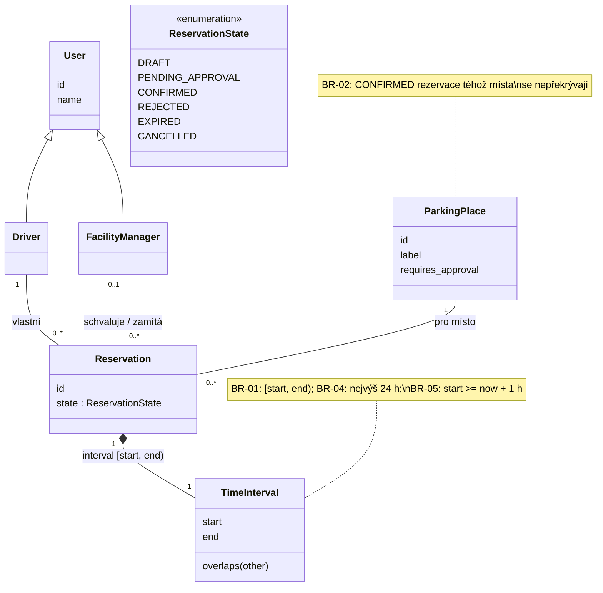
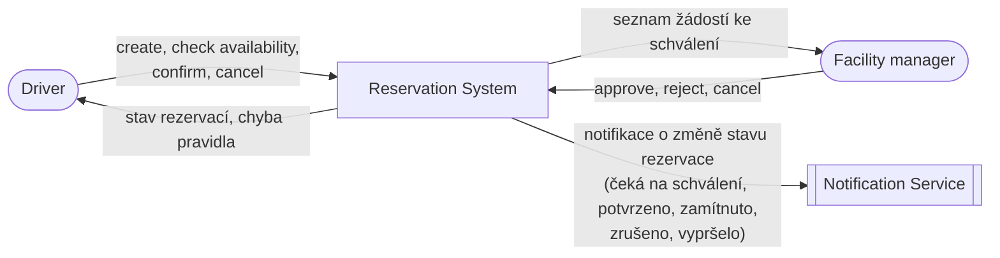
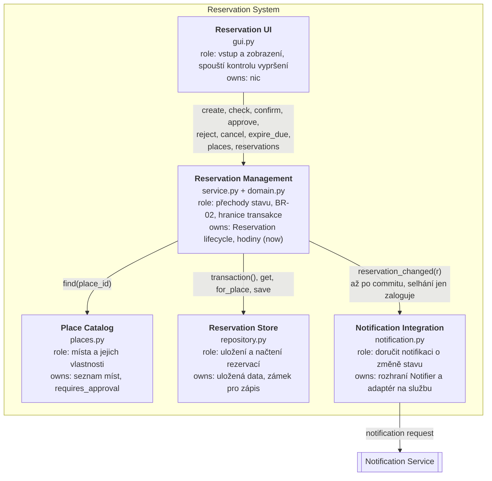
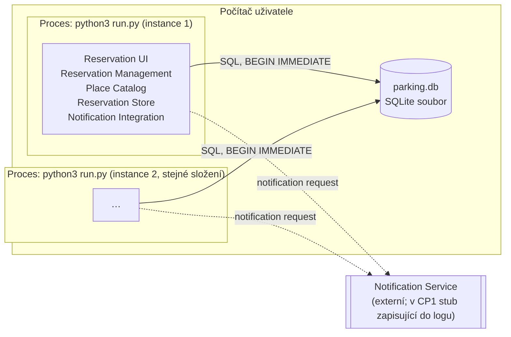
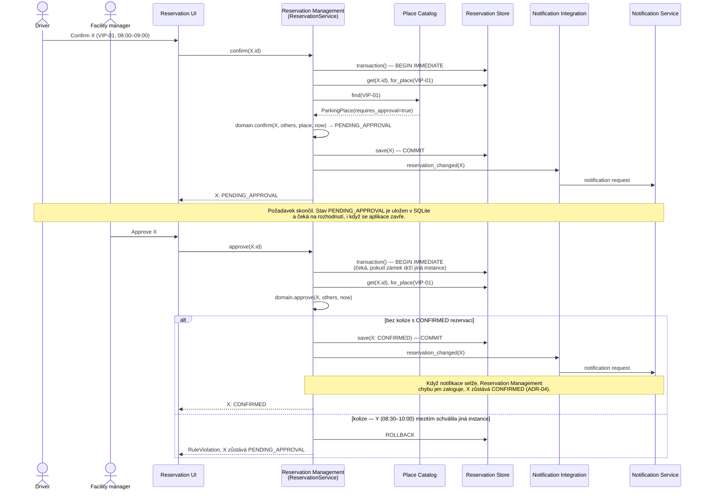
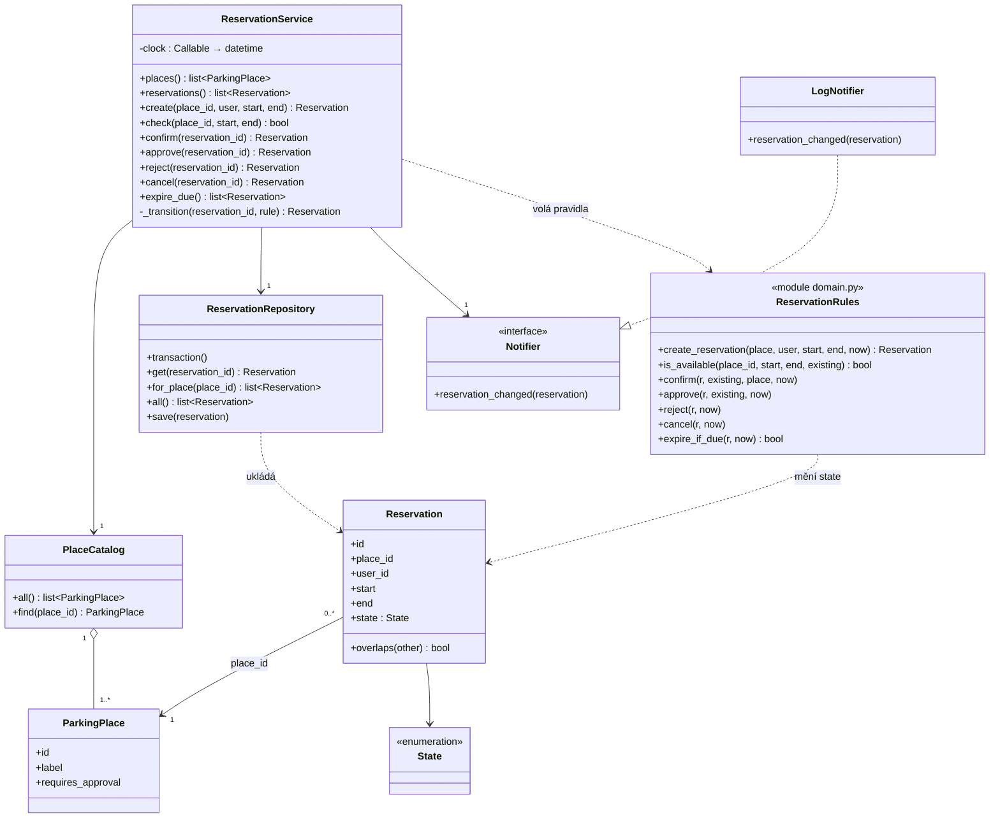
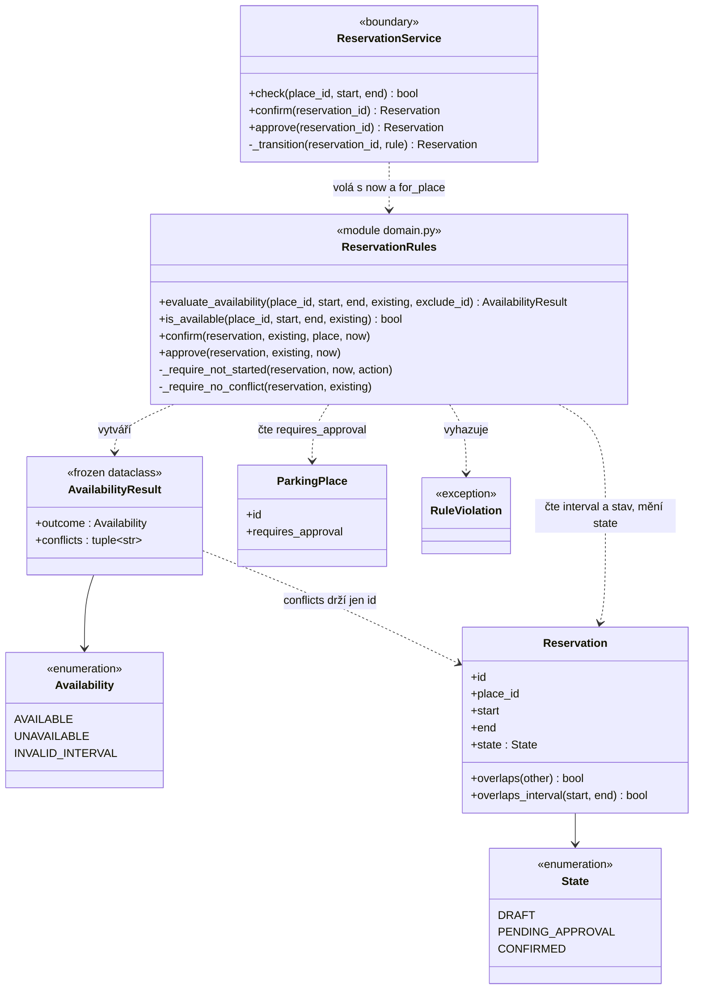
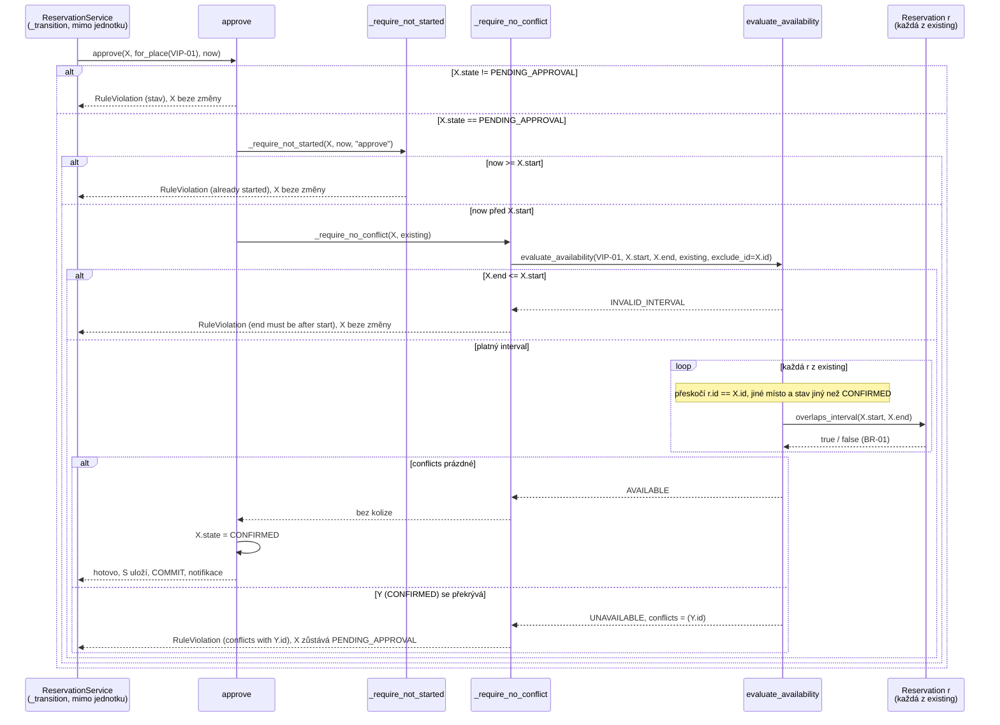
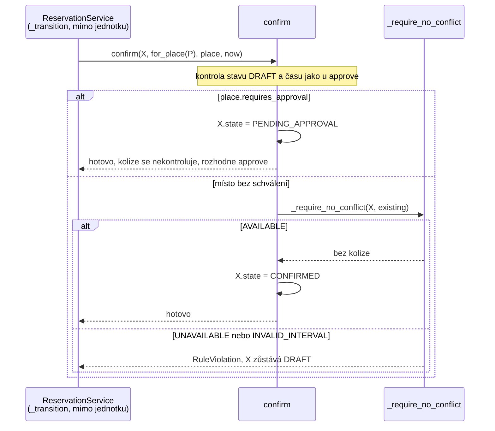

# Architecture and decisions

## Overview

```
tests/              → exercise domain rules, the service, persistence, races
                      and the architecture rule
src/parking/
  gui.py            → Reservation UI: input and display, calls the service only
  service.py        → Reservation Management: every state change, transaction
                      boundary, clock (ADR-04)
  domain.py         → ParkingPlace, User, Reservation, State + business rules
  places.py         → Place Catalog
  repository.py     → Reservation Store: SQLite persistence, transaction()
  notification.py   → Notification Integration: Notifier + LogNotifier stub
```

The domain module has no I/O. Clients (the GUI now, the HTTP API in CP1)
go through `ReservationService`; it loads the reservation and the other
reservations of its place, applies the domain rule and saves, all inside
one `transaction()`, and notifies the Driver after the commit. See C03
below, ADR-04.

## Decisions

### D1 – Python, standard library only
Chosen over Java + Spring Boot because the whole team knows Python, nothing
has to be installed, and a clean checkout runs with one command. Cost: no
framework for the later HTTP layer; we will add one (FastAPI or Flask) when
the walking skeleton needs it.

### D2 – SQLite as the database
Zero configuration, file-based, ships with Python. Sufficient for CP1 and
for the expected load of a single car park. Revisit if the *Unknown* in the
Project Frame turns out badly.

### D3 – Times stored as UTC ISO-8601 strings
SQLite has no datetime type. The C01 spike (`docs/evidence-and-evolution.md`)
showed that `isoformat()` / `fromisoformat()` round-trips timezone-aware
datetimes losslessly, so no custom adapters are used.

---

# C03 — Architektura

Navazuje na Specification Baseline v0.2 (`docs/specification.md`) a na
drivery AD-01 a AD-02 z C02.

**Zvolený scénář:** OP-03 Confirm na místě se schválením (`VIP-01`)
→ `PENDING_APPROVAL` → později OP-05 Approve / Reject / Expire.
**Komplikace:** souběh. Dvě překrývající se žádosti téhož místa schvaluje
manažer ve dvou instancích aplikace současně (REQ-04, REQ-06).

## Část A — AS-IS (mapování současné implementace)

Stav kódu na commitu `bb72a77` (konec C02).

| Prvek (soubor) | Co dnes dělá | Jaký stav drží | Na čem závisí |
|---|---|---|---|
| `gui.py` `App` | formulář a tabulka, **skládá use-casy**: vybere místo, dodá `now`, zavolá doménovou funkci uvnitř `repo.apply(...)`, spouští vypršení | pevný seznam míst `PLACES` | `domain`, `repository` |
| `domain.py` | pravidla BR-01..BR-05, přechody `confirm`, `approve`, `reject`, `cancel`, `expire_if_due` | — (čisté funkce, bez I/O) | nic |
| `repository.py` `ReservationRepository` | SQLite, `save`/`get`/`for_place`, `apply(id, operation)` provede předanou operaci pod `BEGIN IMMEDIATE` | tabulka `reservation` | `domain` |
| `run.py` | spustí GUI nad souborem `parking.db` | — | `gui` |

Průchod scénářem v kódu (Approve):
`App.approve` ([gui.py:135](../src/parking/gui.py#L135)) → `repo.apply(rid, lambda r, existing: approve(r, existing, now))`
→ `BEGIN IMMEDIATE` → `get` + `for_place` → `domain.approve` (kontrola BR-02,
`state = CONFIRMED`) → `save` → `COMMIT`.

**Nálezy:**

- **F1 — Use-case řídí GUI.** Které pravidlo se zavolá, s jakým místem a
  jakým `now`, rozhoduje `App` ([gui.py:129-151](../src/parking/gui.py#L129-L151)).
  Aplikační vrstva neexistuje.
- **F2 — Atomičnost drží repozitář, ale jen když ho klient použije správně.**
  `repo.apply` ([repository.py:38](../src/parking/repository.py#L38)) přijme libovolný
  callback. `App.create` a `App.check` volají `save` / `for_place` mimo něj.
  Kdo zavolá `domain.confirm` mimo `apply`, poruší REQ-04, a nic ho nezastaví.
- **F3 — Katalog míst je v GUI.** `PLACES` včetně `requires_approval`
  ([gui.py:12](../src/parking/gui.py#L12)). Jiný klient by ho musel zkopírovat.
- **F4 — Vypršení spouští jen obnovení tabulky.** `refresh()`
  ([gui.py:93-100](../src/parking/gui.py#L93-L100)). Když nikdo GUI neobnoví,
  `PENDING_APPROVAL` po `start` visí (REQ-08).
- **F5 — Notification Service chybí.** Je jen v Project Frame (C01). V kódu
  není rozhraní ani volání.
- **F6 — Role se nerozlišují.** Approve může stisknout kdokoli. Doména ani
  GUI nezná Facility managera.

## B. Architektonické drivery

| ID | Podklad / zdroj | Proč ovlivňuje architekturu | Otázka, kterou musí architektura vyřešit |
|---|---|---|---|
| AD-01 | BR-02, REQ-04, REQ-06, Část A F2 | dva souběžné požadavky (Confirm/Approve) mohou oba vidět „bez kolize“; dnes BR-02 platí jen proto, že GUI volá `repo.apply` | kde se dělá autoritativní rozhodnutí o potvrzení a kde leží hranice transakce, aby BR-02 platilo pro každého klienta? |
| AD-02 | REQ-06..REQ-08, OP-05, Část A F4 | rozhodnutí manažera přichází později, stav musí přežít konec požadavku i zavření aplikace; vypršení závisí jen na čase | kdo vlastní stav `PENDING_APPROVAL` a kdo provádí pozdější přechod (approve / reject / expire)? |
| AD-03 | Project Frame „External boundary“ (C01), Část A F5 | změna stavu je uložená dřív, než se odešle notifikace; Notification Service může selhat | má selhání notifikace změnit výsledek Confirm/Approve a kdo řeší opakování? |
| AD-04 | README CP1 (`POST /reservations`), Část A F1, F3 | přibude druhý klient (HTTP); logika složená v GUI by se musela zkopírovat a mohla by se rozejít | kde musí žít řízení use-casů a katalog míst, aby se všichni klienti chovali stejně? |

AD-01 a AD-02 jsou z C02. AD-03 vychází z hranice systému z C01, AD-04
z nálezů Části A a z plánu CP1. Role (F6) jako driver nebereme. Patří k
přihlašování, které CP1 zatím nevyžaduje (viz zbývající rizika).

## C1. Doménový třídní model

Pojmy pro scénář Confirm → Approve. `TimeInterval` je v kódu zatím jen
dvojice `start`/`end` v `Reservation`. Jako pojem ho uvádíme kvůli BR-01.



Oproti C02 je nové jen to, že role Driver a Facility manager jsou
pojmenované. Facility manager rozhoduje o žádosti (OP-05). V kódu role zatím
nejsou (Část A F6).

## C2. Odpovědnosti systému

| # | Zdroj | Odpovědnost | Co musí rozhodovat / vlastnit | Jeden vlastník? | Důvod | Seskupit s | Oddělit od |
|---|---|---|---|---|---|---|---|
| R1 | Confirm, Approve, Cancel + statechart v0.2 | rozhodnout, zda je přechod lifecycle povolen | přechody stavů `Reservation` | ano | různé části nesmí rozhodnout odlišně | R2, R3 (stejný stav) | UI, SQLite (jiný důvod změny) |
| R2 | BR-02, REQ-04, REQ-06 | vyhodnotit kolizi a zachovat BR-02 i při souběhu: čtení, kontrola a zápis jako jeden nedělitelný krok | rozhodnutí o potvrzení při kolizi, hranice transakce | ano | kdyby atomičnost zajišťoval každý klient sám, jeden ji vynechá (F2) | R1 | UI (klient ji nesmí obejít) |
| R3 | OP-05, AD-02 | spravovat čekající žádost o schválení | stav `PENDING_APPROVAL` a jeho uzavření approve / reject / expire | ano | stav přežívá požadavek i zavření aplikace | R1 (je to stav lifecycle) | spouštěč vypršení (R4) |
| R4 | REQ-08, AD-02 | spustit kontrolu vypršení v čase | **kdy** se kontrola spustí, ne **zda** žádost vyprší | ne (spouštěčů může být víc, rozhodnutí je R1/R3) | plynutí času nemá aktéra | — | R1/R3 (jiný důvod změny: provoz a plánování) |
| R5 | Část A F3, REQ-03 v0.2 | poskytnout katalog míst včetně `requires_approval` | seznam míst a jejich vlastnosti | ano | Confirm se podle místa větví; dva katalogy = dvě chování | — | UI (dnes je katalog v GUI) |
| R6 | C01 spike, D2 | uložit rezervace a načíst je pro kontrolu kolize | uložený stav, zámek pro zápis | ano | jediný zdroj pravdy pro všechny instance | — | pravidla R1/R2 (jiná technologie; SQLite se může vyměnit, Unknown z C01) |
| R7 | AD-03, Project Frame C01 | oznámit Driverovi změnu stavu rezervace (čeká na schválení, potvrzeno, zamítnuto, zrušeno, vypršelo) | doručení a případné opakování | podle návrhu | externí služba může selhat a její výpadek musí mít jasný význam | — | R1/R2 (jiná failure boundary a externí technologie; nesmí být uvnitř transakce) |
| R8 | AD-04, README CP1 | přijmout požadavek uživatele a zobrazit výsledek | nic nerozhoduje, přechod jen vyžaduje | ne | přibude HTTP klient vedle GUI | — | R1–R7 (jiný důvod změny: prezentace a protokol) |

## D. Hlavní rozhodovací otázka

**Rozhodovací otázka:** Kde má být vlastněno provádění přechodů stavu
`Reservation` (Confirm, Approve, Reject, Cancel, Expire) včetně hranice
transakce, aby BR-02 a statechart v0.2 platily stejně pro každého klienta
(GUI dnes, HTTP v CP1) i ve chvíli, kdy schválení přijde později?

Vychází z AD-01 a AD-04 a dotýká se AD-02 a AD-03. Mění vlastnictví
(kdo smí měnit stav), závislosti (kdo smí sahat na úložiště) i interakci
(kde se volá notifikace).

## E1. Alternativy

**Alternativa A — klient skládá use-case, repozitář drží transakci** (dnešní
stav, jen rozšířený o dalšího klienta)

```
[GUI]                       [HTTP API (CP1)]
  | vybere místo, now,         | totéž znovu
  | zavolá pravidlo            |
  +--- apply(id, pravidlo) ----+----> [Reservation Store]
  |                                   owns: transakce (BEGIN IMMEDIATE)
  v                                         | volá předané pravidlo
[Reservation Rules] <-----------------------+
```

**Alternativa B — aplikační služba vlastní přechody**

```
[GUI]                [HTTP API (CP1)]
   \                     /
    \  confirm(id), approve(id), reject(id), cancel(id), expire_due()
     v                 v
 [Reservation Management]
 owns: přechody stavu, transakce, katalog míst, hodiny (now)
     | pravidla           | transaction(), get, save        | po commitu
     v                    v                                 v
 [Reservation Rules]   [Reservation Store]       [Notification Integration]
```

Rozdíl: v A závisí každý klient na úložišti i na pravidlech a sám rozhoduje,
co, s jakým místem a s jakým `now` se zavolá. V B klient zná jen službu.
Úložiště a pravidla použije jen ona.

Zvažovali jsme i variantu C: vynutit BR-02 v databázi triggerem. Zavrhli
jsme ji, protože pravidlo by bylo dvakrát (Python a SQL) a REQ-03 v0.2
(větvení podle místa) by v triggeru zůstalo stejně neřešené.

## E2. Porovnání vůči driverům

| Driver / kritérium | Alternativa A | Alternativa B |
|---|---|---|
| **AD-01 konzistence BR-02** | platí, jen pokud každý klient pošle pravidlo přes `apply`. Volání `domain.confirm` + `save` mimo něj projde bez chyby a REQ-04 tiše poruší (F2) | jediná cesta k přechodu je metoda služby a ta vždy otevře transakci. Obejití zachytí architektonický test (L2) |
| **AD-02 odložené schválení a vypršení** | stav `PENDING_APPROVAL` přežije v SQLite. Vypršení ale spouští a `now` dodává každý klient sám, dnes jen `refresh()` v GUI | `expire_due()` je operace služby s jedněmi hodinami. Spustit ji může GUI časovač, HTTP i budoucí plánovač |
| **AD-03 selhání notifikace** | každý klient by notifikaci volal sám. Hrozí volání uvnitř callbacku: zámek DB drží během externího volání a výjimka zruší už rozhodnuté potvrzení | jedno místo: služba volá notifikaci až po commitu. Selhání se zaloguje a výsledek přechodu se nemění |
| **AD-04 druhý klient / změna** | HTTP musí zopakovat 6 skladeb use-casu, katalog míst i vypršení. Změna statechartu (v0.3) se dělá v každém klientovi | HTTP je tenký adaptér nad službou. Změna statechartu se dělá ve službě a v doméně |
| **provozní složitost** | jeden proces + SQLite, nic nového | jeden proces + SQLite, nic nového. Přibude jedna vrstva (modul) a skládání závislostí při startu |

## E3. Průchod scénářem v obou alternativách

Scénář: Driver potvrdí `X` (08:00–09:00) na `VIP-01`, později schvaluje
manažer. Mezitím existuje žádost `Y` (08:30–10:00) na stejné místo.

| Krok / událost | Alternativa A | Alternativa B |
|---|---|---|
| Confirm `X` začne | GUI vybere `VIP-01` ze svého `PLACES`, zavolá `repo.apply(X, confirm(..., místo, now))` | GUI zavolá `service.confirm(X)`. Služba si místo najde v katalogu a otevře transakci |
| je potřeba schválení | `domain.confirm` → `PENDING_APPROVAL`, commit. Kdyby měl HTTP klient jinou kopii katalogu bez `requires_approval`, `X` by skončila rovnou `CONFIRMED` | `domain.confirm` → `PENDING_APPROVAL`, commit. Katalog je jen jeden |
| požadavek / aplikace skončí | stav je v SQLite, nic dalšího neběží | totéž |
| schválení přijde později | manažer v GUI: `repo.apply(X, approve(..., now))` | manažer v GUI: `service.approve(X)` |
| **souběh:** dva manažeři ve dvou instancích současně schválí `X` a `Y` | `BEGIN IMMEDIATE` je seřadí, druhé schválení uvidí `CONFIRMED` a selže, **pokud** oba klienti použili `apply`. Klient, který volá `approve` + `save` přímo, způsobí dvě `CONFIRMED` | obě volání jdou přes stejnou metodu služby, a tedy přes stejnou transakci. Skončí právě jedna `CONFIRMED`, druhá zůstane `PENDING_APPROVAL` s chybou kolize |
| `start` uplyne bez rozhodnutí | `X` vyprší, až některé GUI obnoví tabulku | GUI volá `service.expire_due()` při obnovení a periodicky časovačem. Pořád ale jen, když běží aspoň jedna instance |
| Notification Service selže po schválení | neurčeno, záleží na klientovi | `X` zůstane `CONFIRMED`, selhání se zaloguje, notifikace se neopakuje |

Obě alternativy umí požadované chování. Liší se v tom, **kdo za něj ručí**:
v A každý klient zvlášť, v B jedno místo.

## F. ADR

### ADR-04 — Kde se provádějí přechody stavu Reservation a kde leží hranice transakce

**Kontext:** Aplikace splňuje REQ-04 a REQ-06 díky `ReservationRepository.apply`
(`BEGIN IMMEDIATE`). Use-casy ale skládá GUI: volí pravidlo, místo i `now` a
spouští vypršení (Část A F1–F4). CP1 přidá HTTP klienta. Notification
Service ze C01 v kódu chybí (F5).

**Drivery:** AD-01, AD-02, AD-03, AD-04.

**Alternativa A:** klient skládá use-case a volá `repository.apply(id, pravidlo)`.
Transakci drží repozitář, katalog míst a `now` dodává klient.

**Alternativa B:** aplikační služba `ReservationService` (logický prvek
Reservation Management) je jediný vstup pro přechody stavu. Otevírá
transakci, drží katalog míst a hodiny a po commitu volá Notification
Integration. Klienti na úložiště nesahají.

**Rozhodnutí:** Alternativa B.
- Přechody stavu `Reservation` provádí jen Reservation Management. Doménová
  pravidla zůstávají čistá (bez I/O) a volá je jen služba.
- Hranice transakce = jedna metoda služby (`BEGIN IMMEDIATE` … `COMMIT`).
  Repozitář dává `transaction()`, ale pravidla nepřijímá.
- Notifikace se posílá až po commitu, best-effort: selhání nemění výsledek
  přechodu a neopakuje se.
- Vypršení spouští klient přes `expire_due()`. O tom, zda žádost vyprší,
  rozhoduje služba se svými hodinami.

**Důvod:** BR-02 a statechart musí platit nezávisle na tom, kolik klientů
bude a jak pečlivě je někdo napíše (E2 AD-01, E3 souběh). Druhý klient
v CP1 by v A zkopíroval logiku, v B jen zavolá službu. Notifikace má
jedno definované místo mimo transakci.

**Přijaté negativní důsledky:**
- další vrstva a nepřímost: GUI → služba → repozitář;
- služba je společné místo pro všechny use-casy a může přerůst. Při dalších
  operacích (např. EV nabíjení z future pressure) ji rozdělíme po use-casech;
- zámek celé SQLite databáze zůstává (souběžné zápisy se řadí);
- vypršení dál nastane jen tehdy, když běží aspoň jedna instance aplikace;
- notifikace se při výpadku ztratí (žádné opakování ani outbox).

**Rozhodnutí znovu otevřeme, když:**
- přejdeme ze SQLite na serverovou databázi nebo víc procesů na víc strojích
  (Unknown z C01). Pak řešit zamykání po místech místo celé DB;
- bude vyžadováno doručení notifikace nebo vypršení i bez běžícího klienta.
  Pak samostatný worker a outbox tabulka (nový runtime prvek);
- se ukáže, že služba drží logiku, která patří do domény.

## G1. Kontext systému



Vypršení (REQ-08) nemá aktéra, způsobuje ho plynutí času. Proto v kontextu
není. Přihlašování (IdP) projekt zatím nemá (Část A F6).

## G2. TO-BE statická architektura



**Přidělení odpovědností z C2 (každá má jednoho hlavního vlastníka):**

| Odpovědnost | Vlastník |
|---|---|
| R1 rozhodnout o přechodu lifecycle | Reservation Management (pravidla v `domain.py`) |
| R2 BR-02 při souběhu, hranice transakce | Reservation Management (určuje hranici). Reservation Store dává jen mechanismus `transaction()` |
| R3 čekající žádost o schválení | Reservation Management |
| R4 spustit kontrolu vypršení | Reservation UI (časovač a obnovení). Jen spouští, nerozhoduje |
| R5 katalog míst | Place Catalog |
| R6 uložení rezervací | Reservation Store |
| R7 notifikace | Notification Integration (doručení). Význam selhání určuje Reservation Management: výsledek přechodu se nemění |
| R8 vstup a zobrazení | Reservation UI |

**Povolené závislosti** jsou jen ty nakreslené. Zakázané, protože by
obcházely ADR-04:
- Reservation UI → Reservation Store;
- Reservation UI → přechodová pravidla v `domain.py` (`confirm`, `approve`,
  `reject`, `cancel`, `expire_if_due`);
- kdokoli kromě `domain.py` → zápis `Reservation.state`.

**Kde je vidět ADR-04:** UI má jedinou šipku, a to do Reservation
Management. Transakci i notifikaci (po commitu) volá jen Reservation
Management.

## G3. Vlastnictví přechodů ve statechartu v0.2

Rozhodovat znamená ověřit podmínky a přechod provést. Vyžádat znamená jen
zavolat operaci Reservation Management.

| Přechod | Owner rozhodnutí (prvek G2) | Kdo může přechod pouze vyžádat |
|---|---|---|
| `[*] → DRAFT` (create) | Reservation Management | Driver přes Reservation UI |
| `DRAFT → CONFIRMED` | Reservation Management (BR-02 v transakci, místo bez schválení podle Place Catalog) | Driver přes Reservation UI |
| `DRAFT → PENDING_APPROVAL` | Reservation Management (`requires_approval` z Place Catalog) | Driver přes Reservation UI |
| `PENDING_APPROVAL → CONFIRMED` | Reservation Management (BR-02 v transakci) | Facility manager přes Reservation UI |
| `PENDING_APPROVAL → REJECTED` | Reservation Management | Facility manager přes Reservation UI |
| `PENDING_APPROVAL → EXPIRED` | Reservation Management (`now` z vlastních hodin) | Reservation UI (časovač / obnovení, bez aktéra) |
| `DRAFT / PENDING_APPROVAL / CONFIRMED → CANCELLED` | Reservation Management | Driver nebo Facility manager přes Reservation UI |

Kdo je Driver a kdo Facility manager, systém zatím neověřuje (F6).
Vyžadující strana je dána specifikací, ne kódem.

## G4. Runtime / deployment



Jeden deployable (Python aplikace) může běžet ve více instancích nad
jedním souborem SQLite. Souběh mezi instancemi řeší zámek SQLite pro zápis
uvnitř transakce Reservation Management. HTTP API z CP1 bude další proces
se stejnými prvky kromě Reservation UI. ADR-04 se tím nemění.

## H1. Návrhový sekvenční diagram — Confirm na místě se schválením, později Approve

Lifelines odpovídají prvkům G2. Doménová pravidla (`domain.py`) jsou
uvnitř Reservation Management, proto jsou kreslena jako jeho vlastní volání.



## H2. Zaměřený návrhový třídní diagram



Vlastníci operací z H1: `confirm`, `approve`, `transaction` a `reservation_changed`
mají v H2 třídu. `domain.confirm` a `domain.approve` patří modulu
`ReservationRules`, který je součástí Reservation Management (G2).
`ReservationService` a `ReservationRules` dohromady tvoří Reservation
Management, `PlaceCatalog` je Place Catalog, `ReservationRepository` je
Reservation Store a `Notifier` s `LogNotifier` jsou Notification Integration.

## I. Cross-view kontrola

Provedena před změnou kódu.

| Kontrola | Otázka | Výsledek |
|---|---|---|
| C02 ↔ G2 | Umí architektura realizovat požadované chování a pravidla? | Ano. REQ-01..REQ-07 provádí Reservation Management v transakci (REQ-04, REQ-06). REQ-08 rozhoduje Reservation Management, spouští ho ale Reservation UI. Vypršení tedy nastane, jen když běží aspoň jedna instance (přijaté v ADR-04). |
| C2 ↔ G2 | Má každá významná odpovědnost jednoho ownera? | Ano, tabulka přidělení v G2 (R1–R8). Opraveno: R7 měl v G2 vlastníka „zpracování selhání“ v Notification Integration, ale význam selhání určuje ADR-04 v Reservation Management. Upraveno, Notification Integration vlastní jen doručení. |
| G2 ↔ H1 | Používá sekvence pouze existující/povolené závislosti? | Ano: UI→RM, RM→PC, RM→ST, RM→NI, NI→Notification Service. Žádná zpráva z UI nejde do Store ani do pravidel. |
| H1 ↔ H2 | Má každá významná zpráva/operace strukturálního vlastníka? | Ano: `confirm`/`approve` → `ReservationService`, `find` → `PlaceCatalog`, `transaction`/`get`/`for_place`/`save` → `ReservationRepository`, `domain.confirm`/`domain.approve` → `ReservationRules`, `reservation_changed` → `Notifier`. |
| statechart ↔ G3/H1 | Rozhoduje transition správný owner? | Ano, všech 9 přechodů v0.2 rozhoduje Reservation Management. V H1 se `PENDING_APPROVAL` i `CONFIRMED` nastavují v RM (`domain.confirm`, `domain.approve`). |
| G2 ↔ G4 | Je každý logický prvek realisticky namapovaný do runtime? | Ano, všech 5 prvků je v procesu `run.py`, data v `parking.db`, Notification Service mimo proces. |
| ADR ↔ G2/G4 | Je přijaté rozhodnutí skutečně vidět v architektuře? | Ano. UI má jedinou závislost (na RM), transakci i notifikaci po commitu volá jen RM a G4 nepřidává runtime prvek. |

**Rozpory nalezené a opravené v artefaktech:**
1. G2 uváděl operaci `list`, H2 ji neměl. Sjednoceno na `places`, `reservations`.
2. Vlastník selhání notifikace se lišil mezi G2 a ADR-04 (viz C2 ↔ G2).
3. G1 a C2-R7 hlásily notifikaci jen o konečném výsledku, H1 posílá i
   `PENDING_APPROVAL`. Sjednoceno na „každá změna stavu existující
   rezervace“.

## J. AS-IS → TO-BE delta

| Oblast | AS-IS | TO-BE | Akce |
|---|---|---|---|
| řízení use-casů (create, check, confirm, approve, reject, cancel) | `App` v `gui.py` skládá pravidlo, místo a `now` | metody `ReservationService` (`service.py`), GUI je jen volá | CHANGE |
| hranice transakce | `repository.apply(id, callback)` provede libovolné předané pravidlo | `repository.transaction()`. Pravidlo uvnitř volá jen služba, `apply` se ruší | CHANGE |
| zámek SQLite (`BEGIN IMMEDIATE`) | v `_write_lock` | stejný mechanismus v `transaction()` | KEEP |
| katalog míst | `PLACES` v `gui.py` | `PlaceCatalog` v `places.py`, používá ho služba | CHANGE |
| `now` | `App._now()` v GUI | hodiny (`clock`) služby, v testech injektované | CHANGE |
| vypršení | `refresh()` v GUI volá `expire_if_due` přes `apply` | `service.expire_due()`, volané z `refresh()` a z časovače GUI každou minutu | CHANGE |
| notifikace | neexistuje | `Notifier` + `LogNotifier` (`notification.py`), voláno ze služby po commitu, selhání zalogováno | CHANGE |
| doménová pravidla (`domain.py`) | čisté funkce, jediné místo zápisu `state` | stejné | KEEP |
| testy souběhu (`test_concurrency.py`) | volají `repo.apply` | volají `ReservationService` (zpoždění mezi kontrolou a zápisem přes pomalý repozitář) | CHANGE |
| pravidlo závislostí ADR-04 | neověřeno; GUI dnes importuje repozitář i přechodová pravidla | GUI závisí jen na službě, `state` zapisuje jen `domain.py` | VERIFY (L2) |
| doména bez I/O | pravděpodobně platí | `domain.py` neimportuje `sqlite3`, `tkinter` ani jiné moduly `parking` | VERIFY (L2) |

## K. Úprava implementace

Provedeny všechny řádky CHANGE z J (commit `1ab853e`):
- nový `service.py` (`ReservationService`, `open_service`), `places.py`
  (`PlaceCatalog`) a `notification.py` (`Notifier`, `LogNotifier`);
- `repository.py`: `apply(id, callback)` nahrazeno `transaction()`, přibylo
  `all()`;
- `gui.py` volá jen `ReservationService`. Kontrolu vypršení spouští při
  obnovení a každou minutu (`EXPIRY_CHECK_MS`);
- `run.py` zapne logování, kam píše `LogNotifier`;
- `tests/test_concurrency.py` jde přes službu a přibyl test souběžného
  Approve (REQ-06). Nový `tests/test_service.py`.

Chyby nalezené při review změny a opravené před commitem: časovač vypršení
by se po výjimce v `refresh()` přestal plánovat (teď se plánuje před
obnovou).

## L1. Ověření chování

Spuštěno `PYTHONPATH=src python3 -m unittest discover -s tests -v`:
40 testů, OK.

| Ověření | Výsledek | Doklad |
|---|---|---|
| úspěšná cesta: Confirm na `VIP-01` → `PENDING_APPROVAL`, nová instance později Approve → `CONFIRMED`, Driver dostane 2 notifikace | OK | `test_service.test_confirm_on_approval_place_waits_and_later_approve_confirms`; v běžícím GUI řízeném skriptem přes jeho tlačítka (DRAFT → PENDING_APPROVAL → CONFIRMED, notifikace v logu) |
| alternativa: Approve s kolizí → `RuleViolation`, rollback, zůstává `PENDING_APPROVAL`, bez notifikace | OK | `test_service.test_approve_with_conflict_is_rolled_back_and_not_notified` |
| failure: Notification Service selže → `CONFIRMED` zůstává, chyba zalogována | OK | `test_service.test_failing_notification_does_not_undo_the_approval` |
| REQ-08: `expire_due` vyprší jen nerozhodnuté žádosti po `start` | OK | `test_service.test_expire_due_expires_only_undecided_requests_after_start` |
| hranice `start` podle hodin služby | OK | `test_service.test_service_clock_decides_the_start_boundary` |
| souběh: dvě konfliktní Approve ve dvou spojeních (REQ-06), dvě Confirm (REQ-04), Cancel × Confirm | OK, právě jedna `CONFIRMED`; Cancel vyhraje | `test_concurrency` (4 testy) |
| testy souběhu opravdu chytají chybu | po odstranění `BEGIN IMMEDIATE` z `transaction()` selžou 3 ze 4 | mutace, ručně, vráceno |
| příklady ověření z C02 (OP-01..OP-05) | OK, beze změny | `test_domain` (27) + `test_persistence_spike` (2) |

## L2. Architektonické pravidlo

**Architektonické pravidlo:** Stav lifecycle `Reservation` mění jen
Reservation Management (ADR-04, G2, G3). Konkrétně: `.state` se přiřazuje
jen v `domain.py`, přechodová pravidla z `domain.py` volá jen `service.py`,
`gui.py` neimportuje `parking.repository` ani `sqlite3` a `domain.py`
nezávisí na I/O ani na jiných modulech `parking`.

**Kontrola:** `tests/test_architecture.py` projde AST všech
`src/parking/*.py`. Běží s ostatními testy (`unittest discover`).

**Výsledek:**
- TO-BE (commit `3af6de7`): OK, žádné porušení;
- stejná kontrola nad AS-IS kódem `bb72a77` hlásí 7 porušení (`gui.py`
  importuje 6 přechodových pravidel a `parking.repository`). Pravidlo tedy
  dřív neplatilo a řádek VERIFY z J by bez změny neprošel;
- mutace (přiřazení `r.state` v `gui.py`) test shodí.

---

## C05 Detailed Design

Navazuje na C03 (G2, G3, H1, H2, ADR-04). Zůstává uvnitř přijaté hranice
prvku Reservation Management a architekturu nemění.

Postup (L05), každý krok má svou sekci:
1. vybrat jednu architektonickou jednotku — DD-1;
2. odvodit vnitřní odpovědnosti, nejdřív co se rozhoduje, ne třídy — DD-2;
3. určit vlastníky, stav a kontrakty — DD-3, DD-4;
4. navrhnout metody (4A) — DD-7, a algoritmus a rozhodovací tabulky
   (4B) — DD-8; strukturu a interakci ukazují DD-5 a DD-6;
5. odvodit unit/component testy — `tests/test_detailed_design.py`,
   `docs/evidence-and-evolution.md` „C05 — Detailed Design Evidence“;
6. zkontrolovat kód proti návrhu — tamtéž, „Design ↔ implementation
   mismatch“.

DD-1 až DD-9 vznikly před změnou kódu. Po implementaci jsou názvy a
signatury zkontrolované proti kódu (evidence C05).

### DD-1 Selected architecture unit

**Jednotka:** *Availability & Confirmation decision* — rozhodnutí, zda
interval místa koliduje s potvrzenou alokací (BR-01, BR-02), a rozhodnutí
přechodů `confirm` / `approve`, které alokaci vytvářejí.

**Prvek G2:** Reservation Management, část pravidel v `domain.py`
(v H2 modul `ReservationRules`). Volá ji `ReservationService`
(`service.py`), který je pro jednotku hraniční prvek.

**Proč tato jednotka:**
- má skutečnou rozhodovací logiku: polootevřené intervaly `[start, end)`,
  blokuje jen `CONFIRMED`, posuzovaná rezervace se vylučuje, confirm se
  větví podle `requires_approval`, platí časová hranice `start` a záleží na
  pořadí kontrol;
- tady vzniká alokace. BR-02, REQ-04 a REQ-06 stojí na správném výsledku
  této jednotky. C03 rozhodl, *kde* se rozhoduje (ADR-04), C05 řeší, *jak*;
- leží celá uvnitř jednoho prvku G2 a nemá I/O. Jde ji navrhnout a
  otestovat bez změny architektury a bez porušení ADR-04;
- odpovídá vzoru „`AvailabilityPolicy.evaluate(resource, interval,
  existingReservations)`“ z L05.

Celý *Reservation Lifecycle* jsme nevybrali. `reject`, `cancel` a
`expire_if_due` jsou kontroly stavu a času bez vlastní rozhodovací logiky.
Přidaly by objem, ne rozhodnutí.

**Související:** BR-01, BR-02, časová hranice `start` (spec. část A),
OP-02, OP-03 (v0.2), OP-05, REQ-02, REQ-03 (v0.2), REQ-04, REQ-06; scénář
H1 z C03 (Confirm na `VIP-01` → později Approve s kolizí). BR-05 (předstih
1 h) se jednotky netýká. Kontroluje se jen při Create, Confirm a Approve
hlídají jen `now < start`.

**Hranice:**

| Uvnitř (navrhuje se zde) | Vně (jen rozhraní, nenavrhuje se) |
|---|---|
| `evaluate_availability`, `Availability`, `AvailabilityResult` | `ReservationService._transition`: transakce, `now` z hodin, notifikace po commitu (C03, ADR-04) |
| `is_available` (odpověď OP-02 ano/ne pro `ReservationService.check`) | `ReservationRepository.for_place`, `transaction()` |
| `Reservation.overlaps`, `Reservation.overlaps_interval` | `PlaceCatalog.find` (dodá `ParkingPlace`) |
| `confirm`, `approve`, `_require_not_started`, `_require_no_conflict` | `Notifier`, Reservation UI |
| | `create_reservation`, `reject`, `cancel`, `expire_if_due` (jen v tabulce přechodů DD-8) |

### DD-2 Detailed responsibilities

Co se musí rozhodnout nebo udělat. Bez názvů tříd a funkcí:

| # | Odpovědnost | Zdroj |
|---|---|---|
| DR-1 | ověřit, že posuzovaný interval je platný (`end > start`) | BR-01, OP-02 |
| DR-2 | vyloučit posuzovanou rezervaci ze srovnání: rezervace nekoliduje sama se sebou | OP-03, OP-05; seznam rezervací místa z úložiště obsahuje i ji |
| DR-3 | vybrat jen rezervace, které místo blokují: stejné místo a stav `CONFIRMED` | BR-02 |
| DR-4 | rozhodnout překryv dvou intervalů `[start, end)`; navazující intervaly se nepřekrývají | BR-01 |
| DR-5 | vrátit výsledek i důvod: jaký výsledek a se kterými rezervacemi interval koliduje | OP-02, L05 |
| DR-6 | přeložit výsledek na odpověď OP-02 ano/ne; neplatný interval odmítnout | REQ-02 |
| DR-7 | ověřit, že přechod vychází z povoleného stavu: confirm z `DRAFT`, approve z `PENDING_APPROVAL` | statechart v0.2 |
| DR-8 | odmítnout přechod, když `now >= start` | časová hranice `start`, REQ-03, REQ-06 |
| DR-9 | při confirm rozhodnout cílový stav podle toho, zda místo vyžaduje schválení; na místě se schválením kontrolu kolize odložit | REQ-03 v0.2 |
| DR-10 | při vzniku alokace (confirm bez schválení, approve) vynutit BR-02; při kolizi přechod odmítnout a kolizi pojmenovat | REQ-03, REQ-06 |
| DR-11 | zapsat nový stav, a to až po úspěchu všech kontrol; při jakémkoli selhání nechat stav beze změny | ADR-04, chybové výsledky OP-03/OP-05 |
| DR-12 | dodat `now`, rezervace místa a místo a vše provést v jedné transakci | ADR-04 (vně jednotky) |

DR-12 je uvedena, aby bylo vidět, co jednotka **nedělá**.

### DD-3 Design elements and ownership

| Odpovědnost | Vlastník (funkce/třída) | Stav / data | Proč zde? | Co nesmí znát |
|---|---|---|---|---|
| DR-1, DR-2, DR-3, DR-5 | `evaluate_availability` (čistá funkce) | vlastní stav žádný; čte `place_id`, interval, `existing`, `exclude_id` | jedno místo pro BR-02 společné pro Check, Confirm i Approve (spec. „Availability vs. Confirm“: stejné blokující stavy, stejný překryv) | SQLite, hodiny (`now`), notifikace, `requires_approval`, texty chyb pro uživatele |
| DR-4 | `Reservation.overlaps_interval` (`Reservation.overlaps` na ni jen deleguje) | `start`, `end` rezervace | interval jsou data `Reservation` (C1 `TimeInterval`); BR-01 je zapsané jednou | stav rezervace, ostatní rezervace |
| DR-6 | `is_available` | — | zachová rozhraní OP-02 (`bool`) pro `ReservationService.check` | id kolizí (OP-02 odpovídá jen ano/ne) |
| DR-7, DR-9, DR-11 pro `DRAFT → …` | `confirm` | mění `reservation.state` | přechod je pravidlo domény (G3) | transakci, katalog (dostane hotové `place`), notifikace |
| DR-7, DR-11 pro `PENDING_APPROVAL → CONFIRMED` | `approve` | mění `reservation.state` | přechod je pravidlo domény (G3) | `requires_approval` (stav `PENDING_APPROVAL` už znamená místo se schválením) |
| DR-8 | `_require_not_started` | čte `reservation.start`, `now` | jedna hranice pro confirm, approve, reject i cancel (spec. „Časové hranice“) | odkud `now` pochází |
| DR-10 | `_require_no_conflict` | — | confirm i approve vynucují BR-02 stejně (spec. „REQ-06 vs. BR-02“) a stejně hlásí kolizi | `requires_approval`, čas |
| DR-12 | `ReservationService._transition` (vně) | transakce, `clock`, `for_place` | ADR-04 | obsah BR-01/BR-02 (pravidla jen volá) |

Každá odpovědnost DR-1 až DR-12 má právě jednoho vlastníka. DR-7 a DR-11
jsou rozdělené po přechodech, každý přechod má jednu funkci.
`AvailabilityResult` a `Availability` nejsou vlastníci odpovědnosti. Jsou
to data, která vrací `evaluate_availability` (DD-4). `ParkingPlace` dodává
Place Catalog (R5 z C03). Jednotka z něj čte jen `requires_approval`.

### DD-4 Key interface(s) / contract(s)

Názvy výsledků přebírají slovník REQ-02: `AVAILABLE` / `UNAVAILABLE`.
„Zamítnuto, žádná odpověď“ z OP-02 je `INVALID_INTERVAL`.

```
<<function>> evaluate_availability                   domain.py, Reservation Management

evaluate_availability(place_id: str, start: datetime, end: datetime,
                      existing: list[Reservation],
                      exclude_id: str | None = None) -> AvailabilityResult

Input:     place_id     místo, o kterém se rozhoduje
           start, end   posuzovaný interval [start, end)
           existing     rezervace ke srovnání; smí obsahovat jiná místa, všechny stavy
                        i posuzovanou rezervaci (služba předává for_place)
           exclude_id   id rezervace, která se ze srovnání vynechá
Output:    AvailabilityResult(outcome: Availability, conflicts: tuple[str, ...])
Pre:       všechny datetime (start, end, časy v existing) jsou timezone-aware;
           v aplikaci UTC (D3, spec. „now = čas serveru v UTC“)
Post:      outcome == INVALID_INTERVAL  ⇔  end <= start, a pak conflicts == ()
           conflicts == id těch r z existing (v pořadí existing), pro které platí
                        r.id != exclude_id ∧ r.place_id == place_id
                        ∧ r.state == CONFIRMED ∧ r.overlaps_interval(start, end)
           outcome == UNAVAILABLE       ⇔  end > start ∧ conflicts != ()
           outcome == AVAILABLE         ⇔  end > start ∧ conflicts == ()
           existing ani žádná rezervace se nezmění
Failures:  obchodní výsledek nikdy není výjimka: neplatný interval je INVALID_INTERVAL;
           porušená Pre (naive × aware datetime) → TypeError z porovnání = chyba volajícího
Side effects: žádné (bez I/O, bez hodin, bez zápisu)
```

`conflicts` nese id, ne objekty `Reservation`. Výsledek je neměnná hodnota
(`frozen` dataclass) a nikdo přes něj nemůže změnit stav rezervace
(ADR-04).

Vyloučení podle `exclude_id` (DR-2) a filtr místa (DR-3) jsou záruky
kontraktu, dnes je služba nepotřebuje. `for_place` vrací jen jedno místo a
uložená kopie posuzované rezervace je při confirm `DRAFT` a při approve
`PENDING_APPROVAL`, takže neblokuje. Bez těchto filtrů by výsledek
záležel na tom, co volající do `existing` vloží. Doplněno po kontrole
kódu (evidence C05, mutace M3 a M4).

```
<<function>> is_available                            odpověď OP-02 pro ReservationService.check

is_available(place_id: str, start: datetime, end: datetime,
             existing: list[Reservation]) -> bool

Post:      True  ⇔  evaluate_availability(place_id, start, end, existing).outcome == AVAILABLE
Failures:  end <= start → RuleViolation("end must be after start")   (OP-02: žádná odpověď)
Side effects: žádné
```

```
<<function>> confirm                                 OP-03 (v0.2)

confirm(reservation: Reservation, existing: list[Reservation],
        place: ParkingPlace, now: datetime) -> None

Pre:       place.id == reservation.place_id (místo z PlaceCatalog)
           existing = rezervace místa, smí obsahovat i reservation
           now a časy rezervací jsou timezone-aware
Post:      place.requires_approval   → reservation.state == PENDING_APPROVAL
                                       (kolize se nekontroluje, odloženo na approve)
           ¬place.requires_approval  → reservation.state == CONFIRMED a žádná CONFIRMED
                                       rezervace z existing (kromě reservation) se nepřekrývá
Failures:  RuleViolation, reservation.state beze změny; první platná v tomto pořadí:
           1. state != DRAFT            "cannot confirm a <STATE> reservation"
           2. now >= reservation.start  "cannot confirm a reservation that has already started"
           3. end <= start              "end must be after start"            (jen bez schválení)
           4. kolize s CONFIRMED        "... must not overlap; conflicts with <id>, ..."
                                                                             (jen bez schválení)
Side effects: mění jen reservation.state; neukládá, nenotifikuje
```

```
<<function>> approve                                 OP-05, REQ-06

approve(reservation: Reservation, existing: list[Reservation], now: datetime) -> None

Pre:       jako confirm (bez place)
Post:      reservation.state == CONFIRMED a žádná CONFIRMED rezervace z existing
           (kromě reservation) se nepřekrývá
Failures:  RuleViolation, reservation.state beze změny; první platná v tomto pořadí:
           1. state != PENDING_APPROVAL "cannot approve a <STATE> reservation"
           2. now >= reservation.start  "cannot approve a reservation that has already started"
           3. end <= start              "end must be after start"
           4. kolize s CONFIRMED        "... must not overlap; conflicts with <id>, ..."
Side effects: mění jen reservation.state
```

**Kolaborace s hraničním prvkem** (vně jednotky, beze změny z C03):
`ReservationService._transition` předá `for_place(r.place_id)` (obsahuje
i `r`, proto `exclude_id`) a `now` ze svých hodin. Při `RuleViolation`
`transaction()` provede rollback a notifikace se nepošle. Jednotka
navíc zaručuje, že při selhání stav nezmění ani v paměti. Na rollbacku
tak nezávisí.

### DD-5 Focused structural view

Jen vybraná jednotka. `ReservationRules` je stejný modul `domain.py` jako
v H2, tady jsou jen jeho části z DD-1. H2 dál platí.



U `State` jsou jen stavy, které jednotka rozlišuje. Ostatní jen
neblokují. Diagram ukazuje tři rozhodnutí. Dostupnost je jedna čistá
funkce, kterou sdílí Check (přes `is_available`), Confirm i Approve, takže
BR-02 nemůže mít dvě verze. Výsledek drží id kolizí, ne objekty
`Reservation`, a přes výsledek tedy nikdo stav nezmění (ADR-04).
`ReservationService` je hranice: dodá `now` a `for_place`, pravidla jen
zavolá. `ParkingPlace` čte jen `confirm`.

### DD-6 Detailed sequence

Zoom do kroku `RM->>RM: domain.approve(X, others, now)` z H1 (C03).
Lifelines jsou funkce uvnitř jednotky, ne prvky G2. Scénář: Approve `X`
(08:00–09:00) na `VIP-01`, mezitím mohla jiná instance schválit `Y`
(08:30–10:00).



Confirm má stejné kroky 1 a 2 (stav `DRAFT`, `now` před `start`).
Navíc se větví podle místa ještě před kontrolou kolize (DR-9):



### DD-7 Important methods / operations

Karty operací s návrhovým významem (formát 4A). Gettery a konstrukce dat
nejsou uvedeny (DD-9).

| Operation | Responsibility | Input | Output | Preconditions | Postconditions | Side effects | Failure behavior |
|---|---|---|---|---|---|---|---|
| `evaluate_availability(place_id, start, end, existing, exclude_id=None)` | DR-1, DR-2, DR-3, DR-5 | místo, interval, rezervace ke srovnání, vyloučené id | `AvailabilityResult` | aware datetime | DD-4: `UNAVAILABLE` ⇔ `conflicts` neprázdné; `conflicts` v pořadí `existing` | žádné | neplatný interval je hodnota `INVALID_INTERVAL`; porušená Pre → `TypeError` |
| `Reservation.overlaps_interval(start, end)` a `Reservation.overlaps(other)` | DR-4 | interval / jiná rezervace | `bool` | aware datetime | `overlaps_interval`: `self.start < end and start < self.end`; `overlaps`: navíc stejné `place_id` | žádné | `TypeError` při naive × aware |
| `confirm(reservation, existing, place, now)` | DR-7, DR-9, DR-11 | rezervace, rezervace místa, místo, `now` | `None` | DD-4 | DT-C1, DT-C3, DT-C4 | mění jen `reservation.state` | `RuleViolation`, stav beze změny (DT-C2, DT-C5, DT-C6) |
| `approve(reservation, existing, now)` | DR-7, DR-11 | rezervace, rezervace místa, `now` | `None` | DD-4 | DT-P1 | mění jen `reservation.state` | `RuleViolation`, stav beze změny (DT-P2, DT-P3, DT-P4) |
| `_require_not_started(reservation, now, action)` | DR-8 | rezervace, `now`, název akce | `None` | aware datetime | projde jen pro `now < reservation.start` | žádné | `RuleViolation("cannot <action> a reservation that has already started")`, i při `now == start` |
| `_require_no_conflict(reservation, existing)` | DR-10 | rezervace, rezervace místa | `None` | jako `evaluate_availability` | projde jen pro `AVAILABLE` s `exclude_id=reservation.id` | žádné | `INVALID_INTERVAL` → `RuleViolation("end must be after start")`; `UNAVAILABLE` → `RuleViolation` se všemi id z `conflicts` |

### DD-8 Algorithm / decision logic

**Vyhodnocení dostupnosti:**

```
evaluate_availability(place_id, start, end, existing, exclude_id):
    if end <= start:                                   # DR-1
        return (INVALID_INTERVAL, ())
    conflicts = ()
    for r in existing:                                 # pořadí existing se zachová
        if r.id == exclude_id:        continue         # DR-2
        if r.place_id != place_id:    continue         # DR-3
        if r.state != CONFIRMED:      continue         # DR-3, BR-02
        if r.start < end and start < r.end:            # DR-4, BR-01 (overlaps_interval)
            conflicts += (r.id,)
    return (UNAVAILABLE, conflicts) if conflicts else (AVAILABLE, ())      # DR-5
```

Lineární průchod rezervacemi jednoho místa, bez indexu a bez řazení.
`for_place` vrací rezervace jednoho místa ve všech stavech (riziko viz
evidence C05).

**Přechody:**

```
confirm(X, existing, place, now):
    1  if X.state != DRAFT:        fail "cannot confirm a <state> reservation"   # DR-7
    2  if now >= X.start:          fail "... already started"                    # DR-8
    3  if place.requires_approval: X.state = PENDING_APPROVAL; return            # DR-9
    4  _require_no_conflict(X, existing)                                         # DR-10
           result = evaluate_availability(X.place_id, X.start, X.end, existing, exclude_id=X.id)
           INVALID_INTERVAL → fail "end must be after start"
           UNAVAILABLE      → fail "... conflicts with <ids>"
    5  X.state = CONFIRMED                                                       # DR-11

approve(X, existing, now):
    1  if X.state != PENDING_APPROVAL: fail "cannot approve a <state> reservation"
    2  if now >= X.start:              fail "... already started"
    4  _require_no_conflict(X, existing)
    5  X.state = CONFIRMED
```

**Proč toto pořadí** (určuje, která chyba se ohlásí):
- *stav před časem:* operace z nepovoleného stavu je chybná vždy. Hláška
  jmenuje skutečný důvod. `CONFIRMED` rezervace potvrzovaná po `start`
  dostane „cannot confirm a CONFIRMED reservation“, ne „already started“;
- *čas před schválením a kolizí:* po `start` nesmí projít žádný výsledek,
  ani `PENDING_APPROVAL` (spec. „Časová hranice `start`“). Kolize se pak
  ani nevyhodnocuje;
- *schválení před kolizí:* REQ-03 v0.2 odkládá kontrolu kolize na approve.
  Žádost na místo, kde už je kolidující `CONFIRMED`, se přijme jako
  `PENDING_APPROVAL`;
- *neplatný interval před průchodem:* pro nesmyslný interval se kolize
  nepočítají;
- *zápis stavu jako poslední krok:* při jakémkoli selhání zůstane stav
  beze změny bez vracení v doméně (DR-11).

`approve` nedostává `place`. Stav `PENDING_APPROVAL` vzniká jen v DT-C3 a
DT-C4, tedy jen na místě se schválením. Druhá kontrola `requires_approval`
by nic nerozhodla.

**Rozhodovací tabulka — dostupnost** (`evaluate_availability`). Na místě
`P` existuje `B` = 10:00–11:00. Dotaz je na `P`, pokud není uvedeno jinak.

| ID | Dotaz / situace | Podmínka | Výsledek |
|---|---|---|---|
| DT-A1 | 09:00–10:00, `B` `CONFIRMED` | navazuje zleva (`end == B.start`) | `AVAILABLE` |
| DT-A2 | 11:00–12:00, `B` `CONFIRMED` | navazuje zprava (`start == B.end`) | `AVAILABLE` |
| DT-A3 | 10:30–11:30, `B` `CONFIRMED` | částečný překryv | `UNAVAILABLE`, `(B.id,)` |
| DT-A4 | 10:15–10:45, `B` `CONFIRMED` | dotaz leží uvnitř `B` | `UNAVAILABLE`, `(B.id,)` |
| DT-A5 | 09:00–12:00, `B` `CONFIRMED` | dotaz obsahuje `B` | `UNAVAILABLE`, `(B.id,)` |
| DT-A6 | 10:00–11:00, `B` `CONFIRMED` | stejný interval | `UNAVAILABLE`, `(B.id,)` |
| DT-A7 | 10:30–11:30, `B` `CONFIRMED` na jiném místě | jiné místo | `AVAILABLE` |
| DT-A8 | 10:30–11:30, `B` ve stavu `DRAFT`, `PENDING_APPROVAL`, `REJECTED`, `EXPIRED` nebo `CANCELLED` | neblokující stav (BR-02) | `AVAILABLE` |
| DT-A9 | 10:30–11:30, `B` `CONFIRMED`, `exclude_id = B.id` | posuzovaná rezervace sama | `AVAILABLE` |
| DT-A10 | 09:30–11:30, `B` a `C` = 10:45–12:00 obě `CONFIRMED` | víc kolizí | `UNAVAILABLE`, `(B.id, C.id)` v pořadí `existing` |
| DT-A11 | 11:00–11:00 nebo 11:00–10:00 | `end <= start` | `INVALID_INTERVAL`, `()`; `is_available`, `confirm` a `approve` → `RuleViolation` |
| DT-A12 | 10:30–11:30, `existing` prázdné | nic neblokuje | `AVAILABLE` |

DT-A1 až DT-A6 pokrývají vzájemné polohy dvou intervalů (navazuje /
překryv / uvnitř / obsahuje / shodný). DT-A7 až DT-A9 jsou filtry,
DT-A11 je neplatný vstup.

**Rozhodovací tabulka — confirm** (`X` = 08:00–09:00; „kolize“ = překryv
s `CONFIRMED` rezervací téhož místa):

| ID | Stav `X` | `now` vs `X.start` | `requires_approval` | Kolize | Výsledek |
|---|---|---|---|---|---|
| DT-C1 | `DRAFT` | `now < start` | ne | ne | `CONFIRMED` |
| DT-C2 | `DRAFT` | `now < start` | ne | ano | `RuleViolation` s id kolize, zůstává `DRAFT` |
| DT-C3 | `DRAFT` | `now < start` | ano | ne | `PENDING_APPROVAL` |
| DT-C4 | `DRAFT` | `now < start` | ano | ano | `PENDING_APPROVAL` (kolize odložena na approve) |
| DT-C5 | `DRAFT` | `now >= start` (hranice `now == start`) | libovolné | libovolná | `RuleViolation` „already started“, zůstává `DRAFT` |
| DT-C6 | jiný než `DRAFT` | libovolné, i po `start` | libovolné | libovolná | `RuleViolation` „cannot confirm a <STATE> reservation“, stav beze změny |

**Rozhodovací tabulka — approve:**

| ID | Stav `X` | `now` vs `X.start` | Kolize | Výsledek |
|---|---|---|---|---|
| DT-P1 | `PENDING_APPROVAL` | `now < start` | ne (jiné `PENDING_APPROVAL` se nepočítají) | `CONFIRMED` |
| DT-P2 | `PENDING_APPROVAL` | `now < start` | ano | `RuleViolation` s id kolize, zůstává `PENDING_APPROVAL` |
| DT-P3 | `PENDING_APPROVAL` | `now >= start` | libovolná | `RuleViolation` „already started“; žádost později vyprší (`expire_if_due`, mimo jednotku) |
| DT-P4 | jiný než `PENDING_APPROVAL` | libovolné | libovolná | `RuleViolation` „cannot approve a <STATE> reservation“, stav beze změny |

**Přechody statechartu v0.2 a jednotka** (vlastník rozhodnutí je podle G3
vždy Reservation Management):

| Přechod | Funkce | Strážní podmínka v pořadí kontrol | V jednotce? |
|---|---|---|---|
| `DRAFT → CONFIRMED` | `confirm` | `DRAFT` ∧ `now < start` ∧ ¬`requires_approval` ∧ `AVAILABLE` | ano (DT-C1) |
| `DRAFT → PENDING_APPROVAL` | `confirm` | `DRAFT` ∧ `now < start` ∧ `requires_approval` | ano (DT-C3, DT-C4) |
| `PENDING_APPROVAL → CONFIRMED` | `approve` | `PENDING_APPROVAL` ∧ `now < start` ∧ `AVAILABLE` | ano (DT-P1) |
| `[*] → DRAFT` | `create_reservation` | BR-01, BR-04, BR-05 | ne |
| `PENDING_APPROVAL → REJECTED` | `reject` | `PENDING_APPROVAL` ∧ `now < start` (`_require_not_started`) | ne |
| `PENDING_APPROVAL → EXPIRED` | `expire_if_due` | `PENDING_APPROVAL` ∧ `now >= start` | ne |
| `… → CANCELLED` | `cancel` | stav v `CANCELLABLE_STATES` ∧ `now < start` (`_require_not_started`) | ne |

### DD-9 DD decisions intentionally left to code

Tady se zastavujeme, kód je čitelnější než další model:
- **přesné znění textů `RuleViolation`.** DD-4 určuje jen, která chyba
  nastane a co musí hláška obsahovat (stav, „already started“, id kolize).
  Testy kontrolují jen tento klíčový údaj;
- **formát seznamu kolizí ve zprávě** (oddělovač, plné id). GUI zobrazuje
  `id[:8]`, prefix se dohledá;
- **konstrukce dat:** `@dataclass`, `frozen=True`, `str, Enum`, výchozí
  hodnoty polí, generování `id` (`uuid4().hex`);
- **pořadí podmínek uvnitř filtru** `evaluate_availability`. Na výsledek
  nemá vliv, všechny podmínky musí platit současně;
- **mapování na úložiště:** `ReservationRepository._to_reservation`,
  převod ISO stringů (D3), SQL dotaz `for_place`. Patří Reservation Store;
- **prezentace:** jak GUI zobrazí odpověď Check a chybu (`messagebox`),
  rozložení tkinter;
- **gettery a dotazy služby** (`places`, `reservations`; `check` jen
  předá výsledek `is_available`).
